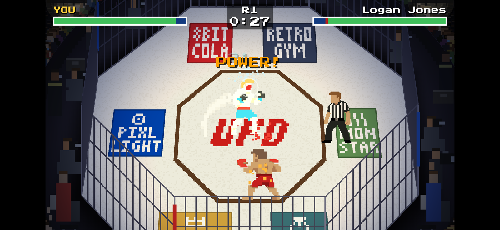

  

  

<a href="https://harrydavidbrown.com">harrydavidbrown.com</a>

---

## [RetroMMA](https://apps.apple.com/app/id6836540151)

An 8-bit MMA game for iPhone and iPad. The fight is played with one thumb (jab, cross, POWER on the beat; the
slip; the counter) inside a career with two promotions, bookmaker odds and a living division of AI fighters.
Godot 4.7, GDScript, about 19k lines. [On the App Store](https://apps.apple.com/app/id6836540151).

- **The rig.** A headless harness plays the real game under a scripted thumb: a bot fitted to my own phone
  fights. It then runs whole careers through the real career code, and statistical gates fail any change that
  breaks the difficulty ladder.
- **No export step.** Sprites are `.aseprite` files, loaded as themselves by an importer written in GDScript
  that reads every layer, the palette and the slices. A Python twin of the same reader lets the gates check
  that the art on disk matches what the code expects.
- **Gates before every commit:** GDScript traps the parser accepts, inferred types hiding a Variant, every
  saved field loaded back, a release build with no dev surface left in it.

## Neural Sudoku solvers

Small transformers (~800k parameters) trained on Sudoku, as a testbed for one question: what does a network
need in order to solve constraint problems that require search, not just deduction?

The grid in the header is one real run, recorded frame by frame: the GIDD ancestral sampler with p_u = 0.2,
64 steps on an easy puzzle. Every unknown cell is resampled at every step, so wrong digits appear, survive,
and get corrected near t = 0.

- [**sudoku-diffusive-uniform**](https://github.com/harry-david-brown/sudoku-diffusive-uniform): GIDD
  (masked / hybrid discrete diffusion, a port of von Rütte et al., ICML 2025) and a looped transformer, scored
  by difficulty band
- [**sudoku-diffusive-masked**](https://github.com/harry-david-brown/sudoku-diffusive-masked): masked
  diffusion, most confident cells first
- [**sudoku-autoregressive-transformer**](https://github.com/harry-david-brown/sudoku-autoregressive-transformer):
  the autoregressive baseline
- [**sudoku-norvig**](https://github.com/harry-david-brown/sudoku-norvig): Norvig's constraint-propagation
  solver

## Older

- [**Monaco-Compiler**](https://github.com/harry-david-brown/Monaco-Compiler): compiler frontend in C (buffer, scanner, parser)
- [**QNX-metronome**](https://github.com/harry-david-brown/QNX-metronome): RTOS message passing and a resource manager on QNX Neutrino
- [**ZugzwangBot**](https://github.com/harry-david-brown/ZugzwangBot): visual chess engine
- [**static.bio**](https://github.com/harry-david-brown/static.bio): link-in-bio pages compiled to static HTML, no client-side JS ([notes](https://github.com/harry-david-brown/static-bio-engineering-notes))
- [**SnackTrackAPI**](https://github.com/harry-david-brown/SnackTrackAPI) / [**SnackTrackApp**](https://github.com/harry-david-brown/SnackTrackApp): receipt ingestion; Node.js, PostgreSQL, Redis, React Native
